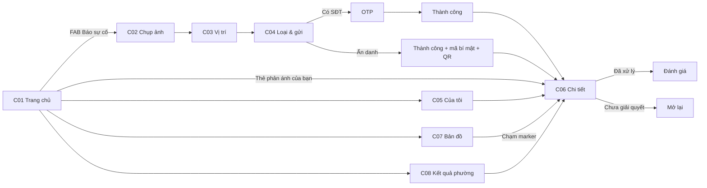

# UI/UX GUIDELINES – Trấn Biên Kết Nối

Phiên bản: 1.0 · Áp dụng cho mọi màn hình trong `spec.md` mục 6.  
Mục tiêu: người dùng **nhìn là hiểu mình đang ở đâu, cần làm gì tiếp, và phường đã làm gì** – không cần hướng dẫn.

Thứ tự ưu tiên khi thiết kế: **hành vi thật của người dùng → tính năng bắt buộc của đề → thẩm mỹ**.

---

## 1. Thiết kế theo khoảnh khắc của người dùng

Mỗi màn hình phục vụ một khoảnh khắc cụ thể. Thiết kế bắt đầu từ câu hỏi: *người dùng đang ở đâu, cầm máy thế nào, đang nghĩ gì?*

| Khoảnh khắc | Bối cảnh thật | Người dùng nghĩ | Thiết kế phải làm | Màn |
|---|---|---|---|---|
| **Thấy sự cố** | Đứng ngoài đường, một tay cầm máy, có thể đang dắt xe, nắng chói | "Chụp nhanh rồi đi" | Camera là việc đầu tiên; nút lớn ở vùng ngón cái; không bắt gõ chữ | C01 → C02 |
| **Xác nhận nơi chốn** | Vẫn đứng tại chỗ | "Nó có biết đúng chỗ không?" | Tự lấy GPS, hiện địa chỉ bằng chữ để đọc lại, chỉ cần bấm "Đúng rồi" | C03 |
| **Chọn loại & gửi** | Muốn xong cho nhanh | "Cái này là loại gì nhỉ?" | 4 ô lớn có hình; ảnh vừa chụp luôn hiện phía trên để đối chiếu | C04 |
| **Vừa gửi xong** | Còn nghi ngờ | "Gửi được thật chưa? Rồi ai lo?" | Mã phản ánh to, câu nói rõ bước tiếp theo và khi nào có tin | C04 thành công |
| **Vài ngày sau** | Ở nhà, nhớ ra, tò mò | "Xong chưa?" | Mở app là thấy ngay thẻ phản ánh của mình với trạng thái trên trang chủ | C01 |
| **Xem chi tiết** | Có thời gian đọc | "Đang kẹt ở đâu? Ai làm? Bao giờ xong?" | "Cập nhật mới nhất" bằng 1 câu; mốc tương lai có ngày dự kiến; chậm thì nói thẳng là chậm | C06 |
| **Nhận tin đã xử lý** | Bấm từ tin nhắn | "Sửa thật không?" | Ảnh trước/sau đặt cạnh nhau ngay đầu màn | C06 |
| **Đánh giá** | Ít kiên nhẫn | "Bấm cho xong" | Sao + chip bấm sẵn, gõ chữ là tuỳ chọn, ghi rõ "chưa đến 30 giây" | C06 |
| **Xem quanh mình** | Đi ngang khu phố | "Chỗ kia có ai báo chưa?" | Bản đồ có biểu tượng loại + màu trạng thái; luôn có danh sách thay thế | C07 |
| **Kiểm tra phường** | Hoài nghi | "Phường có làm thật không?" | Số liệu đơn giản + dòng ảnh trước→sau của việc vừa xong | C08 |

Quy tắc rút ra:
1. **Hành động trước, thông tin sau.** Ở luồng gửi, mỗi màn chỉ có một việc và một nút chính ở đáy.
2. **Luôn trả lời 3 câu hỏi ở mọi hồ sơ:** đang ở bước nào · ai đang lo · khi nào xong.
3. **Bằng chứng thay cho lời hứa:** ảnh, thời điểm, tên bộ phận.
4. **Nói thật khi chậm.** Che giấu trễ hạn làm mất niềm tin nhanh hơn chính việc trễ hạn.
5. **Không bắt người dân quyết định thay cán bộ.** Người dân không chọn mức ưu tiên.

---

## 2. Phân tích mẫu tham khảo

Nguồn: ảnh chụp do chủ dự án cung cấp ngày 24/11/2026. Lấy **pattern**, không sao chép màu sắc, logo, minh hoạ hay bố cục chi tiết của bất kỳ sản phẩm nào.

| # | Mẫu | Pattern đáng học | Quyết định | Áp dụng ở |
|---|---|---|---|---|
| R1 | Road issues reporting system (Dribbble) – màn camera | Mở luồng bằng camera toàn màn hình, khung ngắm | **Điều chỉnh:** dùng camera gốc của điện thoại (`capture`) thay vì tự dựng khung ngắm – ổn định hơn trên iPhone và trình duyệt trong Zalo; màn C02 là một ô chụp lớn chiếm phần lớn màn hình | C02 |
| R1 | – trang chủ | Thẻ "phản ánh của bạn" ở đầu trang với thanh tiến trình ngang có mốc giờ | **Áp dụng** | C01 |
| R1 | – trang chủ | "Phản ánh từ người khác" kèm khoảng cách | **Áp dụng** (khối "Quanh đây", 3 mục) | C01 |
| R1 | – điều hướng | Thanh điều hướng đáy với nút camera nổi ở giữa | **Áp dụng** | Mọi màn người dân |
| R1 | – form gửi | Ảnh giữ ở phía trên, form nằm trong bottom sheet; dòng vị trí có nút "Đổi" | **Áp dụng** cho C03, C04 | C03, C04 |
| R1 | – form gửi | Người dân chọn mức ưu tiên Low/Medium/High | **Không áp dụng** – ai cũng chọn "Cao"; ưu tiên do cán bộ quyết định | – |
| R2 | Complaint tracking (khái niệm "Fixing broken complaints") | Chip "Chậm" + dòng "Chưa có cập nhật 3 ngày" | **Áp dụng**: chip "Chậm hơn dự kiến" công khai cho người dân | C05, C06 |
| R2 | – | Hộp "Cập nhật mới nhất" giải thích bằng 1–2 câu | **Áp dụng** | C01, C05, C06 |
| R2 | – | Timeline dọc có cả mốc tương lai, ghi "Dự kiến trong 2 ngày", tên người phụ trách | **Áp dụng**, nhưng ghi tên **bộ phận**, không ghi tên cá nhân cán bộ | C06 |
| R2 | – | Ô Trước/Sau có sẵn từ đầu, ô Sau ghi "Chưa cập nhật" | **Áp dụng** – người dân biết trước sẽ được xem ảnh kết quả | C06 |
| R2 | – | Nút "Escalate issue" | **Chưa làm** – cần quy trình khiếu nại thật; ghi vào hướng mở rộng | – |
| R3 | My City Report (Nhật Bản) – bản đồ | Marker là biểu tượng loại sự cố, màu theo trạng thái | **Áp dụng**, thêm viền + chú giải để không phụ thuộc màu | C07 |
| R3 | – danh sách | Thẻ có ảnh trước → sau và nhãn "Đã xử lý" | **Áp dụng** cho dòng "Vừa xử lý xong" | C08 |
| R3 | – | Nút tạo phản ánh nổi trên bản đồ | **Áp dụng** (FAB camera dùng chung) | C07 |
| R4 | Feedback form | Sao kèm biểu cảm, chip bấm nhanh "What did you think?", ô góp ý tuỳ chọn, "less than 60 seconds" | **Áp dụng**, chip đổi theo số sao | C06 |
| R5 | Ứng dụng phản ánh tiếng Việt – màn "Phản ánh" | Tách "Cộng đồng / Cá nhân"; tab trạng thái Chờ tiếp nhận · Đã tiếp nhận · Đang xử lý · Đã xử lý · Đã từ chối; nút tìm kiếm và bản đồ ở góc | **Áp dụng từ vựng quen thuộc**: nhãn bước 1 đổi thành **"Chờ tiếp nhận"**; tab trạng thái trong C05. Giữ C05 (cá nhân) và C07 (cộng đồng) là hai màn riêng vì đề yêu cầu tách | C05, C07 |

---

## 3. Kiến trúc điều hướng người dân

```
┌─────────────────────────────────────────────┐
│                 (nội dung màn)              │
│                                             │
├────────┬────────┬─────────┬────────┬────────┤
│  Trang │  Của   │  ( 📷 ) │  Bản   │  Kết   │
│  chủ   │  tôi   │ Báo sự  │  đồ    │  quả   │
│        │        │   cố    │        │ phường │
└────────┴────────┴─────────┴────────┴────────┘
```

- Thanh điều hướng đáy 5 mục, nút giữa là nút tròn nổi (FAB) **"Báo sự cố"**, đường kính 64px, luôn hiện.
- Icon luôn đi kèm nhãn chữ.
- Trong luồng gửi (C02–C04) **ẩn thanh điều hướng**, thay bằng nút "←" và "✕ Huỷ" để người dùng tập trung.
- Chuông thông báo ở góc phải trên của Trang chủ và Của tôi.

### Sơ đồ luồng chính



---

## 4. Wireframe chuẩn (mobile 390px)

Wireframe mô tả **bố cục và thứ tự ưu tiên thông tin**, không phải thiết kế thị giác cuối.

### C01 – Trang chủ

```
┌──────────────────────────────────┐
│ Phường Trấn Biên            🔔 2 │
├──────────────────────────────────┤
│ ┌──────────────────────────────┐ │
│ │ Thấy chỗ hư hỏng?            │ │  ← thẻ kêu gọi, nền primary
│ │ Chụp một tấm, phường sẽ lo.  │ │
│ │ [ 📷  Báo sự cố           ]  │ │
│ └──────────────────────────────┘ │
│ Phản ánh của bạn                 │
│ ┌──────────────────────────────┐ │
│ │ 🚧 Mặt đường · TB-0065       │ │
│ │ ●━━━━━●━━━━━○━━━━━○          │ │  ← tiến trình 4 bước
│ │ Chờ   Đã     Đang  Đã        │ │
│ │ t.nhận t.nhận xử lý xử lý    │ │
│ │ Đã giao Đội duy tu đường,    │ │  ← cập nhật mới nhất (1 câu)
│ │ dự kiến xong trước 27/11.    │ │
│ └──────────────────────────────┘ │
│ Quanh đây              Xem bản đồ│
│ 💡 Đèn đường · Đang xử lý  250 m │
│ 💧 Ngập nước · Đã xử lý    400 m │
│ 🗑 Rác thải · Chờ t.nhận   600 m │
│ ┌──────────────────────────────┐ │
│ │ Tháng 11: 47/64 đã xử lý  →  │ │  ← dẫn sang C08
│ └──────────────────────────────┘ │
├──────────────────────────────────┤
│ Trang chủ  Của tôi ( 📷 ) Bản đồ Kết quả │
└──────────────────────────────────┘
```

- Chưa có phản ánh nào → ẩn khối "Phản ánh của bạn", thẻ kêu gọi lên cao hơn.
- Có nhiều phản ánh → thẻ trượt ngang, có chấm phân trang (theo R1).

### C02 – Chụp ảnh

```
┌──────────────────────────────────┐
│ ←   Báo sự cố  ①──②──③       ✕   │
├──────────────────────────────────┤
│ ┌──────────────────────────────┐ │
│ │                              │ │
│ │            📷                │ │  ← ô chụp ≈ 60% chiều cao
│ │     Chạm để chụp ảnh         │ │
│ │                              │ │
│ └──────────────────────────────┘ │
│  Mẹo: lùi xa một chút để thấy    │
│  cả xung quanh chỗ bị hư.        │
│                                  │
│  [ 🖼  Chọn ảnh có sẵn ]          │  ← nút phụ
├──────────────────────────────────┤
│ [        Tiếp tục          ] (mờ)│
└──────────────────────────────────┘
```

Sau khi chụp: ô chụp thành ảnh xem trước lớn, bên dưới là dải ảnh nhỏ + ô "+" (tối đa 3), nút "Chụp lại" trên ảnh.

### C03 – Vị trí (ảnh trên, sheet dưới)

```
┌──────────────────────────────────┐
│ ←   Báo sự cố  ①──②──③       ✕   │
│ ┌──────────────────────────────┐ │
│ │ [ảnh vừa chụp, cao 120px]    │ │  ← luôn thấy ảnh để đối chiếu
│ └──────────────────────────────┘ │
│ ╭──────────────────────────────╮ │
│ │ Chỗ bị hư ở đâu?             │ │
│ │ ┌──────────────────────────┐ │ │
│ │ │        🗺 bản đồ  📍      │ │ │  ← chạm để dời ghim
│ │ └──────────────────────────┘ │ │
│ │ 📍 Đường Hưng Đạo Vương,     │ │
│ │    gần số 90          [Đổi]  │ │
│ │ Mô tả thêm (không bắt buộc)  │ │
│ │ [ trước nhà số 12...       ] │ │
│ ╰──────────────────────────────╯ │
├──────────────────────────────────┤
│ [      Đúng chỗ này rồi    ]     │
└──────────────────────────────────┘
```

### C04 – Loại & gửi

```
┌──────────────────────────────────┐
│ ←   Báo sự cố  ①──②──③       ✕   │
│ [ảnh 120px]                      │
│ ╭──────────────────────────────╮ │
│ │ Đây là chuyện gì?            │ │
│ │ ┌────────────┐┌────────────┐ │ │
│ │ │    💡      ││    💧      │ │ │  ← ô ≥ 96px, chọn thì viền đậm
│ │ │ Đèn đường  ││ Ngập nước  │ │ │     + dấu ✓
│ │ └────────────┘└────────────┘ │ │
│ │ ┌────────────┐┌────────────┐ │ │
│ │ │    🗑      ││    🚧      │ │ │
│ │ │ Rác thải   ││ Mặt đường  │ │ │
│ │ └────────────┘└────────────┘ │ │
│ │ 📍 Hưng Đạo Vương, gần số 90 │ │
│ │                       [Đổi]  │ │
│ │ Mô tả (không bắt buộc)       │ │
│ │ [                          ] │ │
│ ╰──────────────────────────────╯ │
├──────────────────────────────────┤
│ [      Gửi cho phường      ]     │
│   Gửi không để lại số điện thoại │  ← link nhỏ
└──────────────────────────────────┘
```

### C04 – Thành công

```
┌──────────────────────────────────┐
│               ✅                 │
│      Phường đã nhận phản ánh     │
│            TB-0065               │  ← ≥ 32px
│                                  │
│  Tiếp theo: cán bộ phường sẽ     │
│  xem và tiếp nhận, thường trong  │
│  ngày làm việc. Bạn sẽ nhận tin  │
│  nhắn khi có cập nhật.           │
│                                  │
│ [     Theo dõi phản ánh     ]    │
│       Về trang chủ               │
└──────────────────────────────────┘
```

Biến thể ẩn danh: thay đoạn "nhận tin nhắn" bằng khối mã bí mật + QR + "Lưu link theo dõi" + nút phụ "Nhận tin báo cho phản ánh này" (spec AC-C04-11).

### C06 – Chi tiết

```
┌──────────────────────────────────┐
│ ←  TB-0065                  ⤴ Lưu│
│ ┌──────────────────────────────┐ │
│ │ [ảnh gốc]                    │ │
│ └──────────────────────────────┘ │
│ 🚧 Mặt đường   [🔧 Đang xử lý]    │
│               [⏰ Chậm 1 ngày]    │  ← chỉ khi quá hạn
│ 📍 Hưng Đạo Vương, gần số 90     │
│ ┌──────────────────────────────┐ │
│ │ Cập nhật mới nhất            │ │
│ │ Đội duy tu đường đang xử lý. │ │
│ │ Dự kiến xong trước 27/11.    │ │
│ └──────────────────────────────┘ │
│ Hành trình phản ánh              │
│ ● Chờ tiếp nhận    24/11 08:15   │
│ │ Phường đã nhận phản ánh        │
│ ● Đã tiếp nhận     24/11 10:02   │
│ │ Giao Đội duy tu đường          │
│ ● Đang xử lý       25/11 07:30   │
│ │ Dự kiến xong trước 27/11       │
│ ○ Đã xử lý          (dự kiến 27/11)│ ← mốc tương lai màu nhạt
│ Trước            Sau             │
│ ┌──────────┐    ┌──────────┐     │
│ │ [ảnh]    │    │  🖼       │     │
│ │          │    │ Chưa có  │     │
│ └──────────┘    └──────────┘     │
└──────────────────────────────────┘
```

Khi `hoan_thanh`: khối Trước/Sau lên ngay dưới ảnh gốc, kế tiếp là khối "Vấn đề đã được giải quyết chưa?".

### C06 – Đánh giá (bottom sheet)

```
╭──────────────────────────────────╮
│ Bạn thấy kết quả thế nào?    ✕   │
│ Chưa đến 30 giây                 │
│  ☆    ☆    ☆    ★    ☆           │
│ Rất  Không Bình  Hài  Rất        │
│ tệ   hài   thường lòng hài lòng  │
│ Điều bạn thấy (chọn nhiều)       │
│ (Xử lý nhanh) (Sạch sẽ, gọn gàng)│
│ (Làm đúng chỗ) (Được báo tin đủ) │
│ Phường có thể làm tốt hơn gì?    │
│ [ không bắt buộc               ] │
│ [          Gửi đánh giá      ]   │
╰──────────────────────────────────╯
```

Chip đổi theo số sao: 4–5 sao dùng nhóm tích cực; 1–3 sao dùng nhóm "Xử lý chậm", "Chưa triệt để", "Thiếu thông báo", "Ảnh kết quả chưa rõ".

### C07 – Bản đồ quanh tôi

```
┌──────────────────────────────────┐
│ Quanh đây          [Bản đồ|D.sách]│
│ (Tất cả)(💡)(💧)(🗑)(🚧) (Đang xử lý)│ ← chip cuộn ngang
│ ┌──────────────────────────────┐ │
│ │      🟠🚧     🟢💡            │ │
│ │   ◯ 1 km     📍bạn           │ │
│ │         ⚪💧        🟢🗑      │ │
│ │                    [Toàn phường]│
│ │ ⓘ Chú giải                   │ │
│ └──────────────────────────────┘ │
│ ╭──────────────────────────────╮ │ ← thẻ hiện khi chạm marker
│ │ [ảnh] 🚧 Mặt đường · 250 m   │ │
│ │       [🔧 Đang xử lý]        │ │
│ │       3 người cùng báo   Xem →│ │
│ ╰──────────────────────────────╯ │
├──────────────────────────────────┤
│ Trang chủ  Của tôi ( 📷 ) Bản đồ Kết quả │
└──────────────────────────────────┘
```

---

## 5. Component pattern

| Component | Quy tắc |
|---|---|
| **StatusChip** | Icon + chữ + màu nền nhạt + chữ đậm cùng tông. Không bao giờ chỉ là chấm màu. |
| **DelayChip** | "⏰ Chậm {n} ngày" màu amber, xuất hiện cạnh StatusChip khi quá hạn (spec 3.6a). |
| **ProgressBar ngang** | 4 mốc, mốc đã qua đặc, mốc hiện tại có vòng sáng, mốc sau rỗng; nhãn chữ dưới mỗi mốc; giờ dưới nhãn khi có. Dùng ở thẻ C01, C05. |
| **Timeline dọc** | Có cả mốc tương lai (màu nhạt + "dự kiến {ngày}"). Mỗi mốc: tên bước, giờ, 1 câu mô tả. Dùng ở C06. |
| **LatestUpdate** | Hộp nền nhạt, tiêu đề "Cập nhật mới nhất", tối đa 2 câu, luôn có ngày dự kiến hoặc lý do. |
| **BeforeAfter** | Hai ô bằng nhau, nhãn "Trước"/"Sau" phía trên, thời điểm phía dưới; ô trống ghi "Chưa có ảnh sau xử lý". |
| **CategoryTile** | Ô vuông ≥ 96px, icon 32px + nhãn; trạng thái chọn = viền 2px primary + ✓ góc phải + `aria-pressed`. |
| **LocationRow** | "📍 {địa chỉ}" + nút chữ "Đổi" bên phải. |
| **BottomSheet** | Bo góc trên 20px, có tay nắm; nút chính cố định ở đáy sheet. |
| **FAB Báo sự cố** | Tròn 64px, primary, icon camera + nhãn dưới; nổi giữa thanh điều hướng. |
| **ReportCard** | Ảnh 64px · loại (icon + chữ) · mã · địa chỉ 1 dòng · StatusChip · LatestUpdate rút gọn 1 dòng. |
| **RatingSheet** | 5 sao có nhãn chữ, chip theo số sao, ô góp ý tuỳ chọn. |
| **EmptyState** | Minh hoạ đơn giản + 1 câu + 1 nút hành động. |
| **MockLabel** | Nhãn nhỏ "Mô phỏng" viền xám, đặt cạnh mọi nội dung mô phỏng. |

### Vùng ngón cái

- Nút chính của mọi màn mobile nằm ở **1/3 dưới** màn hình, rộng toàn chiều ngang trừ lề 16px.
- Hành động huỷ/quay lại ở góc trên.
- Không đặt hành động phá huỷ cạnh nút chính.

---

## 6. Ngôn ngữ giao diện

| Nguyên tắc | Viết | Không viết |
|---|---|---|
| Nói việc người dùng làm | "Gửi cho phường" | "Submit" / "Hoàn tất biểu mẫu" |
| Nói điều sẽ xảy ra | "Bạn sẽ nhận tin nhắn khi có cập nhật" | "Yêu cầu đã được ghi nhận vào hệ thống" |
| Có ngày cụ thể | "Dự kiến xong trước 27/11" | "Đang được xử lý" (trơn) |
| Thừa nhận chậm | "Chậm hơn dự kiến 1 ngày" | Im lặng |
| Lỗi có cách khắc phục | "Chưa lấy được vị trí. Bạn bật định vị hoặc gõ tên đường nhé." | "Lỗi định vị" |
| Từ quen thuộc với dịch vụ công VN | "Chờ tiếp nhận", "Đã tiếp nhận", "Đang xử lý", "Đã xử lý" | Thuật ngữ nội bộ ("Đã giao", "Mở lại") trên màn người dân |

---

## 7. Giao diện cán bộ (desktop)

Không có mẫu tham khảo riêng; áp dụng cùng nguyên tắc "trả lời 3 câu hỏi":

- Bảng A01 ưu tiên **cái cần làm ngay** (quá hạn → sắp hạn → mới), không ưu tiên cái mới nhất.
- Panel A02 sắp theo thứ tự quyết định: *Đây là gì?* (ảnh, loại) → *Ở đâu?* (bản đồ nhỏ) → *Giao ai, hạn nào?* (đã điền sẵn) → *Nút hành động*.
- Màu đỏ chỉ dùng cho quá hạn; mọi cảnh báo đều có chữ.

---

## 8. Không làm

- Không sao chép màu, minh hoạ, logo, wordmark của các mẫu tham khảo.
- Không bắt người dân chọn mức ưu tiên.
- Không tự dựng khung camera bằng `getUserMedia` ở phiên bản lõi.
- Không dùng animation trang trí trong luồng gửi.
- Không ghi tên cá nhân cán bộ trên màn người dân.
