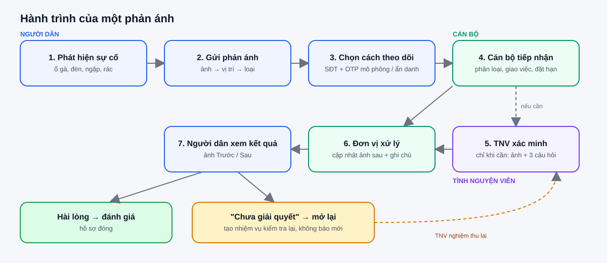
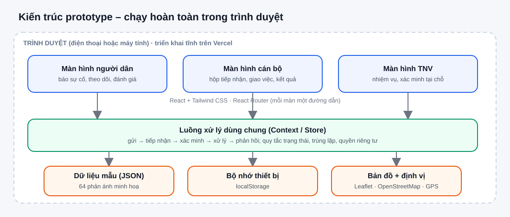

# Trấn Biên Kết Nối

> **Một phản ánh – một hành trình minh bạch.**

**Trấn Biên Kết Nối** là bản thiết kế giao diện web (prototype) giúp người dân báo các sự cố quanh nhà như đèn đường hỏng, ngập nước, rác thải, mặt đường xuống cấp, rồi **theo dõi đến khi sự cố được xử lý xong**.

---

## 1. Vấn đề và người dùng

### Vấn đề: báo xong rồi… không biết chuyện gì xảy ra

| Điều đang gây khó | Hậu quả | Trấn Biên Kết Nối giải quyết thế nào |
| --- | --- | --- |
| Người dân không biết báo cho ai | Ngại báo, hoặc báo nhầm nơi | Chỉ cần chọn loại sự cố, hệ thống tự gợi ý bộ phận phụ trách và hạn xử lý |
| Báo xong không thấy tiến độ | Phải hỏi đi hỏi lại, mất niềm tin | Mỗi phản ánh có trạng thái, mốc thời gian và link theo dõi riêng |
| Không biết sự cố đã được xử lý thật chưa | Nghi ngờ kết quả | Có ảnh trước và sau xử lý; người dân được đánh giá hoặc bấm **"Chưa giải quyết"** |
| Cán bộ nhận phản ánh từ nhiều nơi | Khó biết việc nào mới, việc nào gấp | Một hộp tiếp nhận chung, có trạng thái, hạn và lịch sử xử lý |
| Lo bị lộ thông tin cá nhân | Không dám phản ánh | Có thể gửi ẩn danh; số điện thoại và mã bí mật không bao giờ hiển thị công khai |

### Ai sẽ dùng?

| Người dùng | Họ cần gì | Họ nhận được gì |
| --- | --- | --- |
| **Người dân** | Báo nhanh, không cần hiểu thủ tục | Chỉ 3 bước: chụp ảnh, chọn vị trí, chọn loại sự cố |
| **Người muốn giữ riêng tư** | Theo dõi được mà không lộ số điện thoại | Gửi ẩn danh, nhận mã bí mật hoặc link/QR để tự xem |
| **Người lớn tuổi, ít dùng công nghệ** | Ít bước, chữ dễ hiểu | Mỗi màn hình chỉ một việc chính; có thể gõ địa chỉ thay vì dùng GPS |
| **Cán bộ tiếp nhận** | Xem, phân loại, giao việc đúng người | Hộp tiếp nhận kèm gợi ý bộ phận, hạn xử lý và lịch sử |
| **Tình nguyện viên** | Đi xác minh hoặc kiểm tra lại tại chỗ | Danh sách nhiệm vụ kèm vị trí, ảnh và mẫu báo cáo ngắn |
| **Cộng đồng** | Biết tình hình chung của phường | Bản đồ và bảng thống kê công khai, không có dữ liệu cá nhân |

---

## 2. Luồng sử dụng chính

Hình dưới cho thấy hành trình của **một phản ánh**, từ lúc người dân phát hiện sự cố đến khi có kết quả.

*Hình 1. Luồng xử lý một phản ánh.*

### Tóm tắt 7 bước

1. **Người dân phát hiện sự cố** (ổ gà, đèn hỏng, ngập nước, rác thải).
2. **Gửi phản ánh:** chụp ảnh → chọn vị trí → chọn loại sự cố → viết mô tả ngắn.
3. **Chọn cách theo dõi:** để số điện thoại (xác nhận bằng OTP *mô phỏng*) hoặc gửi ẩn danh (nhận mã bí mật và link/QR).
4. **Cán bộ tiếp nhận:** phân loại, giao cho bộ phận phụ trách, đặt hạn xử lý.
5. **Tình nguyện viên xác minh** (chỉ khi cần): đến hiện trường, chụp ảnh, gửi kết quả.
6. **Đơn vị xử lý:** làm xong thì cập nhật ảnh sau xử lý và ghi chú.
7. **Người dân xem kết quả:** nếu ổn thì đánh giá và đóng hồ sơ; nếu chưa ổn thì bấm **"Chưa giải quyết"**, hồ sơ được mở lại để kiểm tra lại, không phải tạo phản ánh mới.

### Người dân có thể lựa chọn

| Tình huống | Người dân làm gì | Hệ thống phản hồi |
| --- | --- | --- |
| Muốn nhận thông báo | Gửi kèm số điện thoại, xác nhận OTP demo `123456` (*mô phỏng*) | Gửi thông báo *mô phỏng* mỗi khi trạng thái thay đổi |
| Muốn giữ riêng tư | Chọn gửi ẩn danh | Cấp mã bí mật và link/QR; sau này vẫn có thể đăng ký nhận tin cho riêng hồ sơ đó |
| GPS không hoạt động | Gõ địa chỉ hoặc chạm điểm trên bản đồ | Vẫn gửi được phản ánh bình thường |
| Kết quả chưa đạt | Bấm **Chưa giải quyết** | Hồ sơ mở lại và tạo nhiệm vụ kiểm tra lại |

---

## 3. Tính năng sẽ làm trong 24 giờ nếu vào chung kết

**Mục tiêu:** làm cho **một kịch bản chạy trọn vẹn từ đầu đến cuối**, thay vì làm nhiều tính năng dang dở. Mỗi tính năng dưới đây đều có "dấu hiệu hoàn thành" để kiểm tra được.

### Nhóm A. Dành cho người dân

| Tính năng | Làm xong thì thấy gì? |
| --- | --- |
| **Trang chủ và nút "Báo sự cố"** | Người dân vào là biết bấm đâu để báo |
| **Gửi phản ánh trong 3 bước** (ảnh, vị trí, loại và mô tả) | Tạo được một phản ánh đầy đủ ảnh, vị trí, loại sự cố |
| **Gửi bằng OTP mô phỏng hoặc ẩn danh** | Nhận được mã phản ánh, link theo dõi và QR |
| **Trang theo dõi phản ánh** | Thấy rõ đang ở trạng thái nào, hạn dự kiến, lịch sử và ảnh trước–sau |
| **Đánh giá hoặc "Chưa giải quyết"** | Đóng hồ sơ, hoặc yêu cầu kiểm tra lại mà không phải báo mới |

### Nhóm B. Dành cho cán bộ

| Tính năng | Làm xong thì thấy gì? |
| --- | --- |
| **Hộp tiếp nhận** | Cán bộ thấy toàn bộ phản ánh mới ở một nơi |
| **Phân loại và giao việc** | Chọn bộ phận, đặt hạn, hồ sơ đổi trạng thái và có người phụ trách |
| **Cập nhật kết quả** | Đăng ảnh sau xử lý, chuyển hồ sơ sang **Đã xử lý** |
| **Bảng số liệu (KPI)** | Hiển thị **64 phản ánh, 47 đã xử lý, trung bình 3,2 ngày** |

### Nhóm C. Dành cho tình nguyện viên

| Tính năng | Làm xong thì thấy gì? |
| --- | --- |
| **Danh sách nhiệm vụ** | Biết cần đi đâu, kiểm tra việc gì |
| **Xác minh tại hiện trường** | Gửi ảnh và ghi chú, kết quả tự quay về hồ sơ của cán bộ |

### Nhóm D. Dành cho cộng đồng và buổi trình diễn

| Tính năng | Làm xong thì thấy gì? |
| --- | --- |
| **Bản đồ và bảng minh bạch** | Xem tình hình chung của phường, không lộ thông tin cá nhân |
| **Nút "Đổi vai trò"** (góc dưới bên phải mọi màn hình) | Chuyển nhanh giữa 3 vai trò: người dân, cán bộ, tình nguyện viên |
| **Phương án dự phòng** | GPS hoặc bản đồ lỗi vẫn gõ địa chỉ hoặc xem dạng danh sách được |

### Điều kiện bắt buộc trước khi trình diễn

- [ ] Tạo được một phản ánh mới; số điện thoại và mã bí mật **không** xuất hiện ở phần công khai.
- [ ] Cán bộ tiếp nhận, giao việc và cập nhật kết quả có ảnh sau xử lý.
- [ ] Người dân mở lại được hồ sơ, xem tiến trình, đánh giá hoặc chọn "Chưa giải quyết".
- [ ] Bảng số liệu hiển thị đúng 64 / 47 / 3,2 ngày.
- [ ] Mọi thứ không phải thật (OTP, SMS/Zalo, dữ liệu đánh giá) đều gắn nhãn **"Mô phỏng"**.
- [ ] Demo 5 phút chạy liền mạch.

### Tính năng cộng thêm (chỉ làm sau khi luồng chính đã chạy trọn)

Prototype nộp vòng này đã có sẵn bản **mô phỏng** của các tính năng dưới đây. Trong 24 giờ, nhóm chỉ hoàn thiện chúng khi các điều kiện bắt buộc ở trên đã đạt.

| Tính năng | Mức độ trong prototype |
| --- | --- |
| **Chế độ chữ lớn** cho người lớn tuổi | Nút "Aa" phóng to toàn bộ chữ và nút bấm |
| **Cảnh báo phản ánh trùng** và nút **"Tôi cũng gặp"** | So vị trí (≤ 50 m), cùng loại, trong 14 ngày; cán bộ gộp/tách được hồ sơ |
| **Gợi ý loại sự cố** | Gắn nhãn *"Gợi ý mô phỏng"*, người dân luôn tự đổi được |
| **Cán bộ gửi phản ánh hộ** người dân gọi điện | Tạo hồ sơ thay người dân, người dân vẫn theo dõi được bằng mã |

### Chủ động chưa làm

AI nhận diện ảnh thật, nhập bằng giọng nói, OTP/SMS/Zalo thật, tài khoản đăng nhập thật và hệ thống máy chủ (backend).

---

## 4. Kiến trúc công nghệ dự kiến

Prototype **chạy hoàn toàn trong trình duyệt**, không cần máy chủ hay cơ sở dữ liệu thật.

*Hình 2. Kiến trúc công nghệ của prototype.*

### Hiểu đơn giản: giống một quầy phục vụ

| Thành phần | Hiểu đơn giản là… | Công nghệ dùng |
| --- | --- | --- |
| **Giao diện web** | Quầy giao dịch: nơi người dùng nhìn thấy và bấm nút | React, Tailwind CSS |
| **Đường dẫn từng màn hình** | Bảng chỉ đường: mỗi màn hình có một địa chỉ riêng, dễ mở đúng tình huống khi demo | React Router |
| **Luồng xử lý dùng chung** | Bộ phận điều phối: chuyển hồ sơ qua các bước gửi → tiếp nhận → xử lý → phản hồi | Context / Store |
| **Dữ liệu mẫu** | Bộ hồ sơ minh họa có sẵn để demo | Tệp JSON |
| **Bộ nhớ trên thiết bị** | Sổ tay cá nhân: máy tự nhớ hồ sơ đã tạo, không gửi đi đâu | localStorage |
| **Bản đồ** | Hiển thị vị trí sự cố bằng bản đồ mở, miễn phí | Leaflet + OpenStreetMap |
| **Định vị** | Lấy vị trí hiện tại khi người dùng đồng ý | GPS của trình duyệt |
| **Đưa lên mạng** | Gửi một đường link để ban giám khảo mở xem | Vercel *(dự kiến)* |

### Vì sao chọn cách này?

- **Nhanh:** làm được trong 24 giờ, không phải dựng máy chủ.
- **Dễ trình diễn:** chỉ cần một đường link, mở được trên cả điện thoại và máy tính.
- **An toàn:** không dùng dữ liệu hay số điện thoại thật.

> **Giới hạn cần nói rõ:** prototype chưa có máy chủ, cơ sở dữ liệu, tài khoản thật, OTP/SMS thật hay thông báo đẩy thật. Dữ liệu chỉ lưu trên trình duyệt của máy đang demo.

---

## 5. Công cụ trí tuệ nhân tạo đã dùng

Nhóm dùng các công cụ AI sau làm trợ lý trong quá trình làm prototype:

| Công cụ | Dùng vào việc gì |
| --- | --- |
| **Codex (GPT-5)** | Soạn bản đề xuất ban đầu, sắp xếp yêu cầu thành màn hình và luồng |
| **Claude (Anthropic)** | Rà soát đề xuất, viết đặc tả, kế hoạch và kịch bản kiểm thử; review mã nguồn và sửa lỗi |
| **Antigravity (Google)** | Trợ lý lập trình viết mã giao diện theo đặc tả và chụp ảnh kiểm tra giao diện |

| AI hỗ trợ | Con người chịu trách nhiệm |
| --- | --- |
| Sắp xếp yêu cầu thành màn hình, vai trò và luồng sử dụng | Quyết định phạm vi, quy trình và cách diễn đạt phù hợp với người dùng |
| Gợi ý cấu trúc giao diện, mã nguồn và dữ liệu minh họa | Kiểm tra, chỉnh sửa và duyệt kết quả cuối cùng |
| Hỗ trợ rà soát tình huống lỗi, tài liệu và kịch bản demo | Bảo đảm dữ liệu không sai, không dùng thông tin cá nhân thật và không gây hiểu nhầm |

### AI **không** làm những việc sau

- Không tự duyệt phản ánh hay tự đổi trạng thái hồ sơ.
- Không thay thế việc xác minh tại hiện trường.
- Không xử lý số điện thoại hoặc dữ liệu cá nhân thật.

### Về tính năng "gợi ý loại sự cố từ ảnh"

Prototype **chưa dùng AI thật** để nhận diện ảnh. Màn gửi phản ánh chỉ có băng gợi ý mang nhãn **"Gợi ý mô phỏng"**, và người dân luôn có thể tự đổi lựa chọn. Nhận diện ảnh thật là hướng phát triển sau.

---

> **Trấn Biên Kết Nối không chỉ là nơi gửi phản ánh. Đây là cách để mỗi phản ánh có hành trình rõ ràng, có phản hồi và có kết quả người dân nhìn thấy được.**
